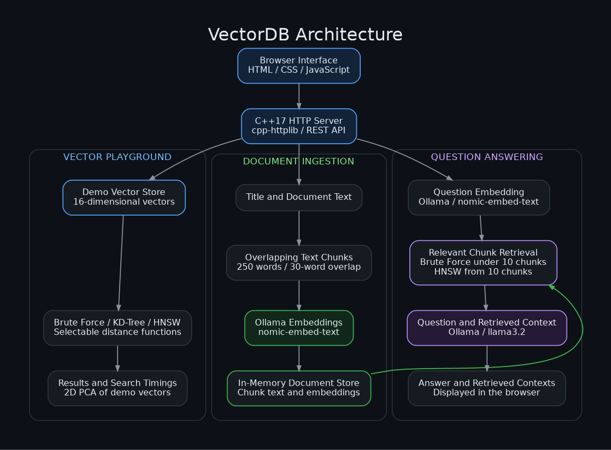

<div align="center">

# VectorDB

### Vector Search · Algorithm Comparison · Local Document Q&A

A C++ application that connects vector indexing, interactive visualization, and retrieval-augmented generation in one workspace.


[Overview](#overview) · [Architecture](#architecture) · [Quick Start](#quick-start) · [API](#api-reference) · [Roadmap](#roadmap)

</div>

---

## Overview

VectorDB explores how vectors can represent information, how indexing strategies retrieve similar items, and how retrieved text can support answers from a local language model.

The application provides two workflows:

| | Vector Search Playground | Document Q&A |
|---|---|---|
| **Purpose** | Explore nearest-neighbor search and compare algorithms | Retrieve relevant text and generate context-aware answers |
| **Data** | 20 predefined vectors across four categories | Text supplied through the interface or API |
| **Representation** | Illustrative 16-dimensional vectors | Ollama embeddings; typically 768 dimensions with the default model |
| **Retrieval** | Brute Force, KD-Tree, or HNSW | Brute Force for small collections; HNSW for larger collections |
| **Interface** | Ranked results, timings, and a PCA scatter plot | Document management, question answering, and retrieved-context inspection |
| **Ollama required?** | No | Yes |

The backend implements the search data structures in C++. Ollama handles embedding generation and language-model inference.

## Capabilities

- **Multiple search strategies:** Compare exhaustive search, spatial partitioning, and graph-based approximate retrieval.
- **Selectable distance functions:** Explore cosine distance, Euclidean distance, and Manhattan distance.
- **Interactive visualization:** Inspect a 2D PCA projection of the demo vectors and highlight search results.
- **Index inspection:** View HNSW node counts, layer statistics, and graph information through the API.
- **Document ingestion:** Split text into overlapping chunks, generate embeddings, and index the results.
- **Local RAG workflow:** Embed a question, retrieve relevant chunks, and send the question and context to a local LLM.
- **HTTP API:** Access vector operations, document retrieval, benchmarks, and service status programmatically.

## Architecture



### Document ingestion and retrieval

1. Text is divided into chunks of up to **250 words**, with a **30-word overlap**.
2. `nomic-embed-text` generates an embedding for each chunk.
3. The backend stores the chunk, its title, and its embedding in memory.
4. A question is embedded using the same model.
5. Retrieval selects nearby chunks using cosine distance.
6. `llama3.2` receives the question and retrieved context to generate an answer.

Document retrieval uses Brute Force for fewer than 10 stored chunks and HNSW from 10 chunks onward. Results are filtered using a cosine-distance threshold of `0.7`.

## Search Algorithms

| Algorithm | Approach | Strength | Trade-off |
|---|---|---|---|
| **Brute Force** | Calculate every distance, sort the results, and return the nearest items | Exact reference for evaluating other methods | Work grows with collection size and vector dimensionality |
| **KD-Tree** | Partition vectors along coordinate axes and prune search branches | Demonstrates spatial indexing and nearest-neighbor traversal | Performance depends on tree shape, dimensionality, and the distance function |
| **HNSW** | Navigate a hierarchy of neighbor graphs | Supports approximate search without scanning every vector | Adds graph memory overhead and trades exactness for search efficiency |

**Comparison notes**

- The current Brute Force implementation takes approximately `O(Nd + N log N)` because it sorts all candidate distances.
- KD-Tree queries do not have a guaranteed logarithmic runtime. Its coordinate-based pruning is suitable for Euclidean and Manhattan distance; cosine results require separate correctness validation.
- Demo HNSW graphs are constructed using cosine distance. Searching with another metric can affect retrieval quality.
- The benchmark endpoint reports individual search timings. The small demo dataset illustrates behavior rather than establishing large-scale performance.

Here, `N` is the number of vectors and `d` is their dimensionality.

## Technology Stack

| Layer | Technology | Responsibility |
|---|---|---|
| Backend | C++17 | Search algorithms, vector storage, chunking, and request handling |
| HTTP | cpp-httplib | Server routes and communication with Ollama |
| Frontend | HTML, CSS, JavaScript | Search controls, document management, and answer display |
| Visualization | Canvas and JavaScript PCA | Interactive projection of demo vectors |
| Embeddings | Ollama + `nomic-embed-text` | Convert document text and questions into vectors |
| Generation | Ollama + `llama3.2` | Generate answers with retrieved context |

## Quick Start

### Requirements

| Dependency | Required for |
|---|---|
| Git | Cloning the repository |
| A C++17-capable compiler | Building the backend |
| A modern browser | Using the interface |
| Ollama | Document embeddings and AI answers |

On Windows, a suitable compiler is available through [MSYS2 UCRT64](https://www.msys2.org/). Install its GCC package and ensure `g++` is available in your terminal.

### 1. Clone the repository

```bash
git clone https://github.com/Abhirampadavala/Vector_Database_cpp.git
cd Vector_Database_cpp
```

### 2. Compile the server

**Linux**

```bash
g++ -std=c++17 -O2 -pthread main.cpp -o vectordb
```

**Windows — PowerShell with MinGW-w64 GCC**

```powershell
g++ -std=c++17 -O2 main.cpp -o vectordb.exe -lws2_32
```

The HTTP library is included as `httplib.h`; no separate frontend build is required.

### 3. Start the application

**Linux**

```bash
./vectordb
```

**Windows**

```powershell
.\vectordb.exe
```

Run the executable from the repository directory so the server can find `index.html`.

Open:

```text
http://localhost:8080
```

The vector playground works even when Ollama is unavailable.

### 4. Enable document embeddings and AI answers

Install [Ollama](https://ollama.com/), then download the default models:

```bash
ollama pull nomic-embed-text
ollama pull llama3.2
```

Start Ollama if it is not already running:

```bash
ollama serve
```

The backend expects Ollama at:

```text
http://127.0.0.1:11434
```

Model download sizes, memory requirements, and inference speed depend on the selected model and hardware.

## Explore the Application

### Search and compare

Enter a concept such as `binary tree`, `linear algebra`, `sushi`, or `basketball`. Select an algorithm and distance function, then inspect the ranked results and highlighted points.

Use **Compare All Algos** to view the timing of each search strategy.

> Demo text queries use a keyword-based 16D representation. They illustrate vector search and do not use the document embedding model.

### Add documents

Open **Documents**, enter a title, paste your text, and select **Embed & Insert**.

Longer text is split into chunks automatically. Each chunk receives an embedding and is stored independently.

### Ask questions

Open **Ask AI** and enter a question related to your documents. Inspect the returned contexts to understand which chunks were retrieved.

The generation prompt also permits the model to use general knowledge, so answers are not restricted exclusively to stored documents.

## API Reference

Base URL:

```text
http://localhost:8080
```

### Vector operations

| Method | Route | Purpose |
|---|---|---|
| `GET` | `/items` | List demo vectors and metadata |
| `POST` | `/insert` | Insert a 16D vector |
| `DELETE` | `/delete/{id}` | Remove a vector |
| `GET` | `/search` | Find nearest neighbors |
| `GET` | `/benchmark` | Compare algorithm timings |
| `GET` | `/hnsw-info` | Inspect HNSW layers, nodes, and edges |
| `GET` | `/stats` | Read vector counts, dimensions, algorithms, and metrics |

**Search parameters**

| Parameter | Description | Default |
|---|---|---|
| `v` | Required comma-separated vector containing 16 numbers | — |
| `k` | Positive number of neighbors to request | `5` |
| `metric` | `cosine`, `euclidean`, or `manhattan` | `cosine` |
| `algo` | `hnsw`, `kdtree`, or `bruteforce` | `hnsw` |

The benchmark route accepts `v`, `k`, and `metric` and runs all three algorithms.

**Example: nearest-neighbor search**

```bash
curl "http://localhost:8080/search?v=0.9,0.8,0.7,0.6,0.1,0.1,0.1,0.1,0.1,0.1,0.1,0.1,0.1,0.1,0.1,0.1&k=3&metric=cosine&algo=hnsw"
```

Search responses include `results`, `latencyUs`, `algo`, and `metric`.

### Documents and AI

| Method | Route | JSON body | Purpose |
|---|---|---|---|
| `POST` | `/doc/insert` | `{"title":"...","text":"..."}` | Chunk, embed, and store text |
| `GET` | `/doc/list` | — | List stored chunks with previews |
| `DELETE` | `/doc/delete/{id}` | — | Delete one chunk |
| `POST` | `/doc/search` | `{"question":"...","k":3}` | Retrieve relevant chunk IDs, titles, and distances |
| `POST` | `/doc/ask` | `{"question":"...","k":3}` | Retrieve context and generate an answer |
| `GET` | `/status` | — | Check Ollama availability, model names, and collection counts |

**Example: insert text**

The following examples use Bash syntax. In PowerShell, use `Invoke-RestMethod` with the same JSON fields.

```bash
curl -X POST "http://localhost:8080/doc/insert" \
  -H "Content-Type: application/json" \
  -d '{"title":"Database Notes","text":"An index helps a database locate records without scanning every row."}'
```

**Example: ask a question**

```bash
curl -X POST "http://localhost:8080/doc/ask" \
  -H "Content-Type: application/json" \
  -d '{"question":"How does an index help a database?","k":3}'
```

The answer response includes the generated text, model name, retrieved contexts, and stored chunk count.

## Project Layout

```text
Vector_Database_cpp/
├── main.cpp       # Search structures, storage, HTTP API, and Ollama integration
├── httplib.h      # Bundled cpp-httplib dependency
├── index.html     # Interface, PCA visualization, and browser-side interactions
├── .gitignore     # Files excluded from version control
└── README.md      # Project documentation
```

The backend is organized around five main components:

| Component | Responsibility |
|---|---|
| `BruteForce` | Exhaustive nearest-neighbor search |
| `KDTree` | Coordinate-based vector indexing |
| `HNSW` | Hierarchical graph construction and approximate retrieval |
| `VectorDB` | Demo vector storage and access to all three algorithms |
| `DocumentDB` / `OllamaClient` | Document retrieval and local model communication |

## Configuration

Current settings are defined in source code.

| Setting | Default | Location |
|---|---|---|
| HTTP server | `0.0.0.0:8080` | `main.cpp` |
| Frontend API URL | `http://localhost:8080` | `index.html` |
| Ollama address | `127.0.0.1:11434` | `OllamaClient` in `main.cpp` |
| Embedding model | `nomic-embed-text` | `main.cpp` |
| Generation model | `llama3.2` | `main.cpp` |
| Chunk size / overlap | `250 / 30` words | `main.cpp` |

For a smaller generation model, download `llama3.2:1b`, change `genModel` in `main.cpp`, and rebuild the server.

Use a consistent embedding model within a running document collection.

## Current Scope

- **In-memory storage:** Inserted vectors and documents are cleared when the process stops. The demo dataset is loaded again at startup.
- **Local development:** Remote hosting requires changes to the frontend API address and service configuration.
- **Visualization:** The scatter plot represents demo vectors. Document markers use separate illustrative 16D representations, rather than projections of the actual document embeddings.
- **Answer display:** The interface animates completed answers with a typewriter effect; backend generation is not token-streamed.
- **Access control:** The current API has no authentication or per-user data isolation.


